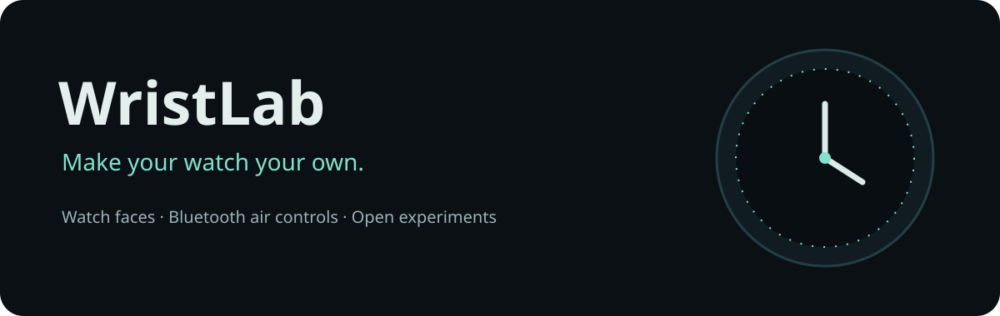
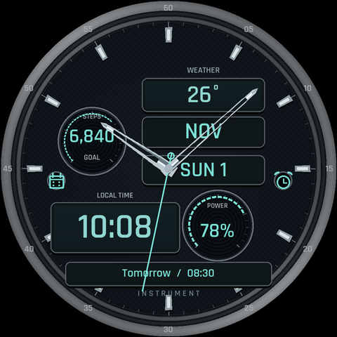
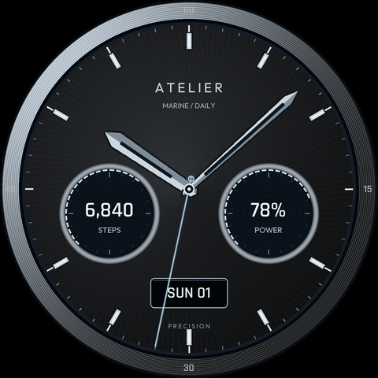
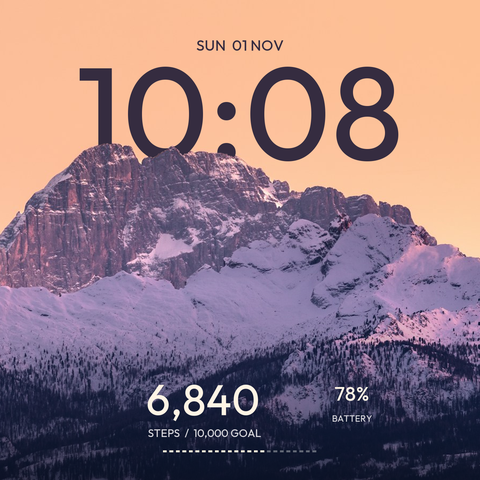

<p align="center"></p>

<p align="center">
<a href="https://github.com/vishwateja2345/WristLab/actions/workflows/ci.yml"></a>
<a href="LICENSE"></a>
<a href="https://github.com/vishwateja2345/WristLab/releases"></a>
</p>

**Custom watch faces. Bluetooth air controls. A practical Wear OS workshop.**

WristLab brings a Galaxy Watch7 project into one place: ten editable Watch Face Format designs, a watch controller, an Android phone companion, the experiments that did not make the cut, and the findings behind each decision.

The controller sends one completed swipe per command over paired Bluetooth. Tap NEXT, or optionally use Samsung's pinch recognition, to advance; a small turn away and return goes back. **Closing the watch controller ends the session on both devices.** There is no always-ready background mode.

This is an early community release, tested on one Galaxy Watch7 and OnePlus 15R pair. It is not a Samsung product or a universal gesture SDK. See [compatibility](docs/COMPATIBILITY.md) before installing.

## Start here

| You want | Go to |
|---|---|
| Install the controller | [Release APKs](https://github.com/vishwateja2345/WristLab/releases/latest) → [setup](docs/SETUP.md) |
| Pick or edit a watch face | [Face gallery](faces/README.md) |
| Build everything yourself | [Build guide](docs/BUILD.md) |
| Let a coding assistant help | Clone this repo and use [PROMPT.md](PROMPT.md) |
| Understand the research | [Findings](docs/RESEARCH.md), [battery](docs/BATTERY.md), [architecture](docs/ARCHITECTURE.md), [project history](docs/PROJECT_HISTORY.md) |
| Add a device report or feature | [Contributing](CONTRIBUTING.md), [roadmap](ROADMAP.md), [issues](https://github.com/vishwateja2345/WristLab/issues) |

## What you get

| Component | Current state |
|---|---|
| **Gesture Lab · watch** | Dark NEXT screen, optional native pinch, gyroscope turn-and-return for previous; user tested. |
| **Gesture Lab Link · phone** | Temporary Accessibility session performs NEXT/PREV swipes. Bluetooth only; user tested in Instagram Reels. |
| **10 watch faces** | Original dark analog/hybrid designs, photographic designs and a mountain depth composition. Device status listed per face. |
| **Battery-aware lifecycle** | No foreground-service notifications, boot receiver, wake lock or idle auto-start. Close the watch activity to stop both controllers. |
| **Research notebook** | Why HID wheel scrolling failed for reels, why completed touch swipes worked, native pinch limits, AOD and battery lessons. |
| **Experiments** | Paused comments/media/navigation work and a separate Watch Deck preview, clearly marked as unfinished. |

<table><tr>
<td align="center"></td>
<td align="center"></td>
<td align="center"></td>
</tr><tr><td align="center">Instrument Hybrid</td><td align="center">Atelier Graphite</td><td align="center">Alpine / Dusk</td></tr></table>

*These are design renders with sample values, not live watch screenshots. Instrument's preview may show seconds; its economy build defaults seconds off.*

## The honest limits

- Samsung Universal Gestures must be enabled by the wearer for pinch. It can show Samsung's focus indicator and affect watch navigation. **WristLab never enables it automatically.** Without it, tap NEXT and use wrist rotation for previous.
- Use the controller's own visible watch screen. Watch-face overlays and home-screen gesture routing were removed after interference with other controls.
- The phone helper must run behind the foreground app during an active session. You enable its Accessibility service for each manual session; it disables itself on an established watch disconnect. No bridge on the computer, Wi-Fi or debugging is needed during use.
- The helper does not detect which app is visible. Keep the intended scrollable screen open. A swipe is not a guarantee that another app advances exactly one video on every device or layout.
- Reels gestures worked for the original tester. Human recognition accuracy, other device combinations, and normal-use battery endurance are not established.
- Photography retains its creators' terms. Copyrighted anime film stills from personal prototypes are excluded from this public project.

## Build and contribute

```sh
git clone https://github.com/vishwateja2345/WristLab.git
cd WristLab
python3 tools/test.py
# With JAVA_HOME and ANDROID_SDK_ROOT configured:
python3 tools/build.py all
```

Builds use the Android SDK directly and create a local development signing key in ignored `build/` unless you supply your own. No private signing keys are published. APK installation never happens as part of a build.

Good first contributions: another device report, measured battery comparisons, accessible UI improvements, or an original face with documented asset rights. [Contribution guide →](CONTRIBUTING.md)

Code and original dial artwork: [Apache 2.0](LICENSE). Fonts and photographs: [asset credits and terms](docs/ASSETS.md). Inspired by [CleanYourTV's community approach](https://github.com/Gathin23/cleanyourtv); independent of that project. Gesture prior art is credited in [NOTICE](NOTICE).
