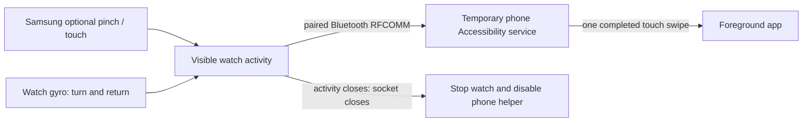

# Architecture and protocol



## Watch

MainActivity exposes one accessibility-click target for NEXT. Decorative drawing is excluded from accessibility navigation. SessionService is a normal activity-scoped service, not a foreground service. `onPause` and task removal stop it. Motion requires a connected, visible, awake, unlocked watch with at least 5% battery. Sampling uses one gyroscope at a requested 50 Hz. It stops during sleep, lock or hidden UI; there is no wake lock or forced screen-on flag.

BackGesture recognizes an outward rotation and return with dead zones, timing windows and cooldown. A NEXT action cancels a pending reverse gesture briefly so pinch motion does not become a reverse command. It is a tuned heuristic, not a learned finger-pose model. Sensors and socket state are in memory; counters in dumpsys are session diagnostics, not stored gesture history.

Connection attempts are bounded. A command has one outstanding reply and a 650 ms watch guard; timed-out commands are not replayed. The screen uses a sparse clock standby layout, while Wear OS controls real screen sleep/AOD.

## Phone

SwipeService is enabled deliberately through Accessibility. It requests gesture dispatch capability, not window-content retrieval or foreground-app events. LinkReceiver only accepts the configured bonded watch. Setup expires after 60 seconds without an established watch connection; established disconnect ends the helper via `disableSelf()`.

The phone performs a 260 ms vertical path at the center of the current display: NEXT from 80% to 22% height; PREV reverses it. It rejects locked-phone, duplicate, stale, busy or invalid requests. The phone gate has a 500 ms guard; there is no continuous scrolling. These proportions worked on the test phone but may require device/app tuning. A completed dispatch means Android completed the gesture, not that an external app necessarily advanced one item.

No foreground app detection means the same swipe can affect whichever screen is visible. There is no Instagram API integration or automatic navigation into Reels.

## Wire format

RFCOMM service UUID: `2fb8f7c0-a624-4bc1-a9f4-e21e12d349b7`.

```text
watch → GLAB/1

phone → READY

watch → NEXT 1

phone → DONE 1

watch → PREV 2

phone → DONE 2

```

ASCII lines are bounded to 64 bytes. NEXT/PREV include increasing integer command IDs; responses echo them. DONE, CANCELLED, REJECTED, LOCKED, OFF and gate refusal responses report the result. Transport trust uses Bluetooth bonding plus the configured device address, not an internet account. There is no application-layer shared secret or extra encryption protocol; do not describe it as independent end-to-end encryption.

Reply queue capacity is eight. No command replay queue exists. `CompatDescriptor`, `HidController` and old cursor/step/pulse helpers are retained for research; only the five active watch classes named in `tools/build.py` enter the controller APK.
