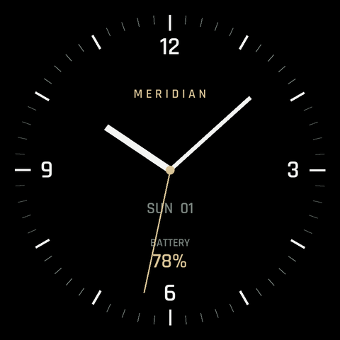
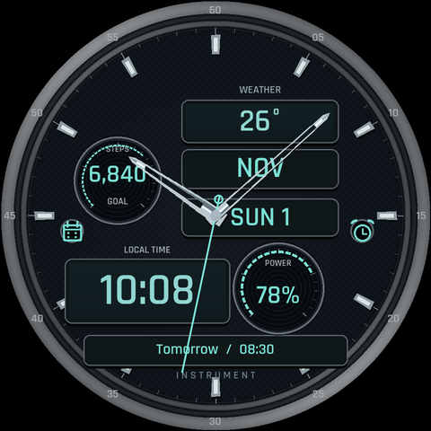
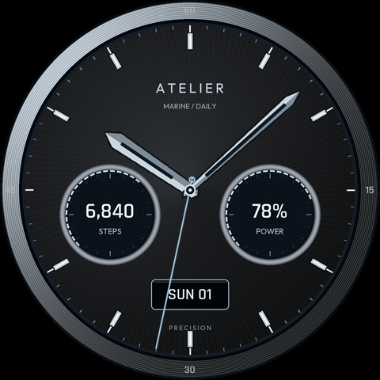
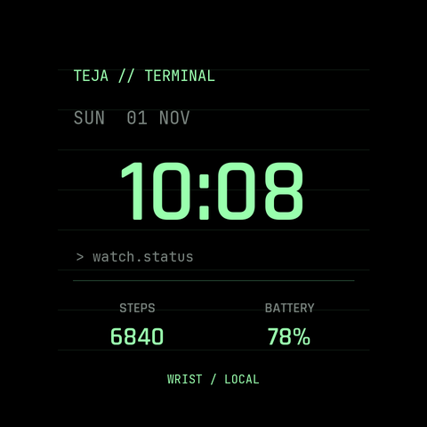
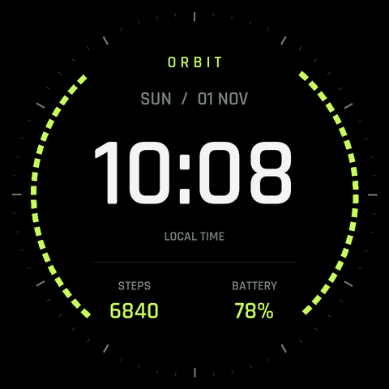
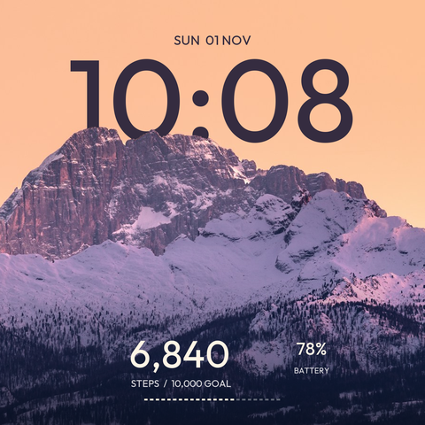
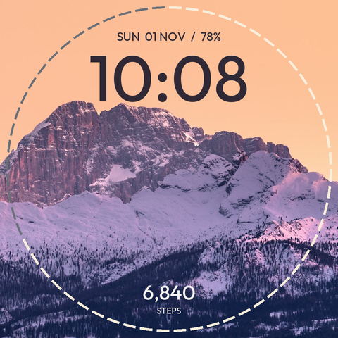
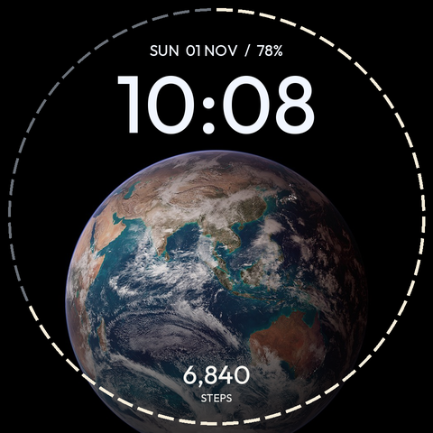
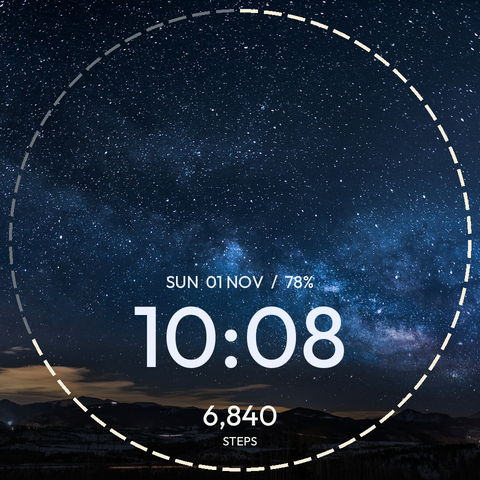
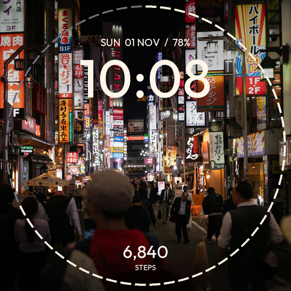

# Watch-face gallery

Ten native Watch Face Format 2 designs for a 480×480 round display. All are resource-only: no executable app code, network permission or custom polling service. Availability and exact rendering depend on the native renderer and complication providers.

Previews contain sample values. Device status below is historical evidence, not a guarantee that every customization/AOD state was checked. No battery endurance result is claimed.

| Face | Preview | Device status |
|---|---|---|
| [Meridian](meridian/) |  | Installed; economy update installed |
| [Instrument Hybrid](instrument/) |  | Installed; economy update installed |
| [Atelier Graphite](atelier/) |  | Installed; interactive rendering checked |
| [Terminal](terminal/) |  | Build checked; device acceptance not recorded |
| [Orbit](orbit/) |  | Build checked; device acceptance not recorded |
| [Alpine / Dusk](alpine/) |  | Preview; not installed |
| [Dolomites](dolomites/) |  | Preview; not installed |
| [Blue Marble](earth/) |  | Preview; not installed |
| [Milky Way](milkyway/) |  | Preview; not installed |
| [Tokyo after dark](tokyo/) |  | Preview; not installed |

## Design notes

- **Instrument:** left steps/progress, right battery, weather, month, weekday/date and native next-event slot; dark carbon/titanium materials, palette and hand options. Economy seconds default off.
- **Meridian:** original analog design; economy resources and seconds default off.
- **Atelier:** graphite/platinum default with marine/emerald alternatives and material/hand accents. Replacing a complication does not change the independent steps/battery background gauges.
- **Photo series:** clock color/size, scene dimming, steps/split/clean edge progress and editable short-text widget. No seconds or animation.
- **Alpine:** mountain foreground mask can put the clock behind the ridge; dark ambient drops imagery.

Build all faces with `python3 tools/build.py faces`. Photo/AOD rendering and compatibility need further device reports. [Assets and licensing](../docs/ASSETS.md) explain why the personal anime prototypes are absent.
